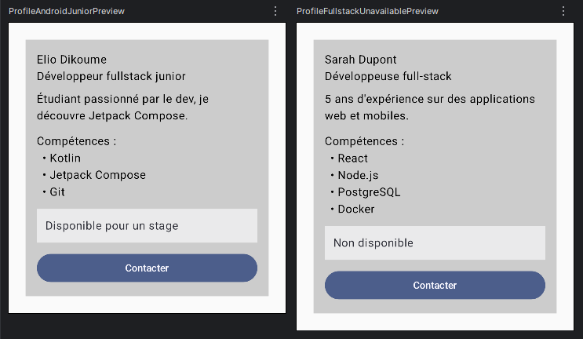

# Profil développeur Compose

## Description

Cette application android jetpack compose affiche une fiche "Profil Developpeur".
L'écran présente le nom, le métier, une description, une liste de skills et la disponibilité.
On retrouve un bouton contact en bas de la fiche et la zone la disponibilité est aussi cliquable.

## Notions utilisées

- Fonctions composables (@Composable)
- Paramètres
- Modifier passé en paramètre
- Padding externe/interne
- Callbacks (() -> Unit)
- Accessibilité de base (Role.Button, contentDescription)
- Previews

## Explications

### 1. Quels composables avez-vous créés ?

- ProfileScreen : écran principal, il fournit les données et place la carte dans l'écran
- ProfileCard : la fiche complète
- ProfileHeader : le nom et le rôle
- SkillList : le titre "Compétences" et la liste des compétences
- SkillItem : une seule compétence
- AvailabilityInfo : zone cliquable qui indique la disponibilité
- ContactButton : bouton réutilisable
- ProfileAndroidJuniorPreview et ProfileFullstackUnavailablePreview : les deux previews

### 2. Quel composable représente l'écran principal ?

C'est le "ProfileScreen"

### 3. Où utilisez-vous un padding externe ?

Je l'utilise sur "ProfileScreen" pour éloigner la carte des bords de l'écran et j'en passe aussi à ses enfants pour gérer l'espacement entre eux

### 4. Où utilisez-vous un padding interne ?

Je l'utilise aussi sur "ProfileScreen" mais pour éloigner son contenue du bord de la carte et aussi dans "AvailabilityInfo" pour eloigner le texte des bords de la zone cliquable

### 5. Quel composant reçoit un callback ?

Les deux zone cliquables donc le bouton et aussi "AvailabilityInfo" reçoivent "onClick: () -> Unit", "ProfileCard" reçoit deux fonctions (vide pour l'instant) et les transmets aux enfants

### 6. Quelle information d'accessibilité avez-vous ajoutée ?

Sur la zone cliquable "AvailabilityInfo", j'indique bien que cette zone à comme rôle un bouton et j'ai rajouté une description

### 7. Pourquoi vos composants peuvent-ils être considérés comme réutilisables ?

- Ils reçoivent leurs données en paramètres au lieu de les écrire en dur, donc on peut faire des preview différentes
- Ils acceptent tous un modifier, ce qui laisse le parent décider de leur placement
- Utilisation de callback : le composant ne décide pas de la logique.
- SkillItem réutilisé pour chaque compétence

## Screen

